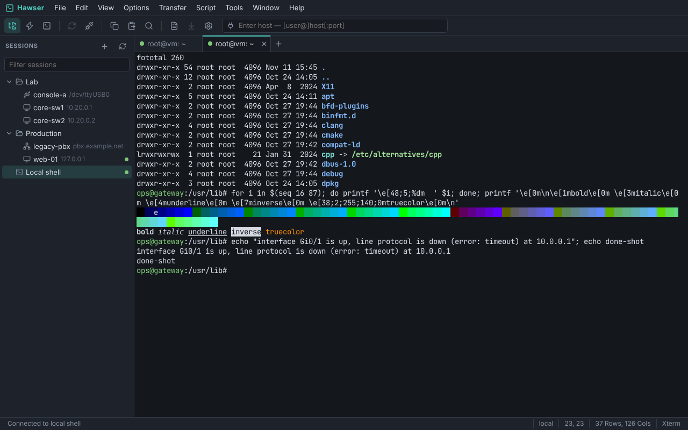
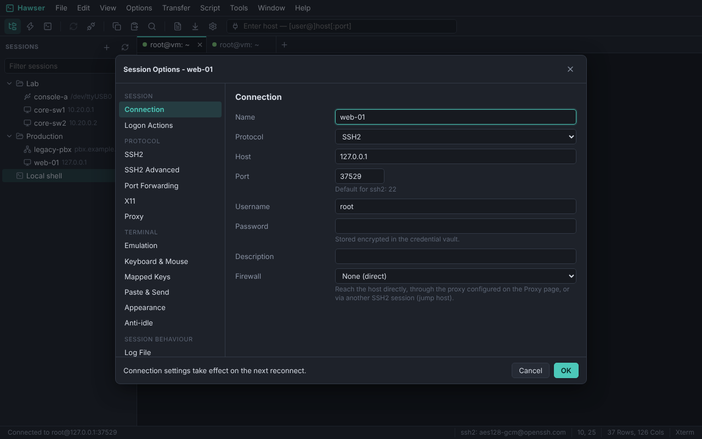
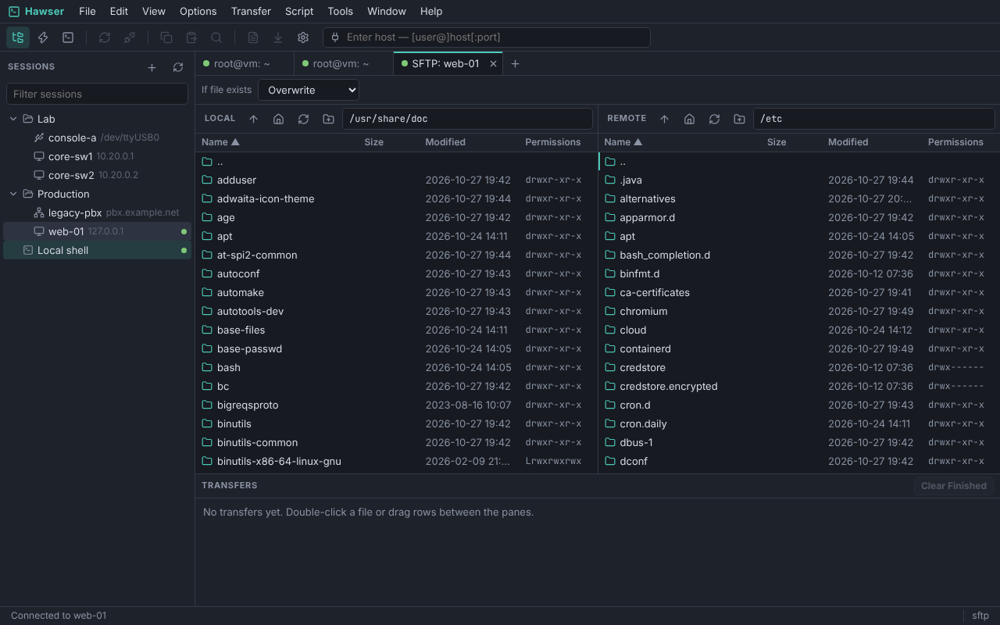

# Hawser

Hawser is an open-source terminal emulator and secure remote-access client
for people who manage many hosts: SSH2, Telnet, Rlogin, raw TCP, serial lines
and local shells in one tabbed window, with a session manager, logging,
scripting, file transfer and port forwarding.

It is an independent, from-scratch implementation in the spirit of commercial
tools such as SecureCRT®. It is not affiliated with or derived from any of
them, and it can import their session files so you can switch without retyping
your inventory.



| Session options | SFTP browser |
| --- | --- |
|  |  |

## Features

**Connections**
- SSH2: password, public-key, keyboard-interactive and agent authentication;
  OpenSSH, PEM and PuTTY (PPK v2/v3) keys; OpenSSH certificates; built-in key
  agent plus the system agent, agent forwarding; host key database with
  ask / accept-new / strict policies and change detection; selectable key
  exchange, cipher, MAC and host-key algorithms; keep-alives
- Local, remote and dynamic (SOCKS4/5) port forwarding, editable while
  connected; X11 forwarding; jump hosts (any SSH2 session can be the
  "firewall" of another), SOCKS4/4a/5 and HTTP CONNECT proxies
- Telnet (NAWS, terminal type, speed, environment), Telnet over TLS, Rlogin,
  raw TCP (optionally TLS), serial ports, local shells (PTY / ConPTY)
- Cloned sessions share one SSH connection; auto-reconnect; anti-idle

**Terminal**
- Emulations: Xterm, VT100, VT102, VT220, VT320, ANSI, Linux console,
  SCO ANSI, Wyse 50 and Wyse 60, with matching function-key sets
- 16 / 256 / true colour, bold, dim, italic, blink, underline styles,
  strike-through, double-width and double-height lines, DEC line drawing and
  national character sets, wide (CJK) and combining characters
- Alternate screen, scroll regions, left/right margins, rectangular area
  operations, mouse reporting (X10 to SGR-pixels), bracketed paste, focus
  events, OSC titles / palette / hyperlinks / clipboard, printer pass-through
- Large scrollback (re-wrapped when the window width changes) with regex search, word/line/block selection, URL
  detection, keyword highlighting, colour schemes (15 built in, custom ones),
  pixel-exact box-drawing and block characters
- Character encodings: UTF-8 and 20 legacy code pages

**Workflow**
- Session manager with folders, filter, drag and drop; sessions store only
  what differs from the Default Session, so changing a default updates all
- Tabs and tiled tab groups, connect bar, Quick Connect, button bar, command
  window that can send to one, a group of, or all sessions
- Session logging (clean text or raw) with file-name and per-line
  substitutions, midnight rotation, custom connect/disconnect lines
- Logon actions (expect/send), mapped keys, configurable shortcuts, session
  locking, multi-line paste confirmation, paced sending for slow devices
- Credential vault: passwords and passphrases are stored encrypted
  (XChaCha20-Poly1305), optionally under an Argon2id master passphrase;
  shared credentials that many sessions can reference
- Sessions that open automatically at startup; raw-data (hex) view of the
  bytes sent and received

**File transfer**
- SFTP tab: dual-pane browser, drag and drop (including from the desktop),
  directory trees, resume, permissions, quick edit, transfer queue
- ZMODEM (auto-start, both directions, crash recovery), YMODEM, XMODEM,
  Kermit, ASCII send; built-in TFTP server

**Scripting**
- A `crt` object model (`crt.Screen.WaitForString`, `Send`, `ReadString`,
  `crt.Session`, `crt.Dialog`, tabs, clipboard, file transfer …) for
  **Python**, **JavaScript** and **VBScript** – existing automation scripts
  written for that API run unchanged in many cases, VBScript included, on
  every platform. Script recorder, logon scripts; see
  [docs/scripting.md](docs/scripting.md) and [`examples/scripts`](examples/scripts).

**Tools**
- Key generation wizard, key conversion (OpenSSH ⇄ PEM ⇄ PPK), public-key
  export, host key manager, connection details
- Import sessions from OpenSSH config, PuTTY, CSV and other terminals'
  session folders / XML exports; export to JSON

## Getting started

Requirements: Go 1.24 or newer (it fetches the Go 1.26 toolchain the
dependencies need automatically) and Node.js 20+ to build. At run time Hawser needs
nothing else; Python scripts need a Python 3 interpreter.

```bash
make build
```

```bash
./hawser
```

Hawser starts its engine on a loopback port and opens the interface in an
application window of an installed Chromium-family browser (Chrome, Edge,
Chromium, Brave); without one it falls back to your default browser. In the
application window every key – including `Ctrl+W`, `Ctrl+T` and `Ctrl+N` –
goes to the terminal. In an ordinary browser tab the browser keeps those for
itself; use full screen (`F11`) there.

```bash
./hawser ssh://admin@router1 "Lab/core-sw1" serial:/dev/ttyUSB0:115200
```

```bash
./hawser --help
```

Targets given to a second `hawser` invocation open as tabs in the running
window. The classic `/SSH2 /L user /P port host`, `/S "session"`,
`/SCRIPT file` switches are accepted too.

See the [user guide](docs/guide.md) and the [scripting reference](docs/scripting.md).

Configuration lives in the per-user config directory (`~/.config/hawser`,
`%AppData%\hawser`, `~/Library/Application Support/hawser`): one small JSON
file per session under `sessions/`, `known_hosts`, `vault.json`, logs and
generated keys.

## Architecture

```
┌──────────────── window (browser engine) ────────────────┐
│ React UI · terminal emulator (TypeScript) · canvas      │
└───────────────▲─────────────────────────────────────────┘
                │ WebSocket: JSON-RPC + binary terminal data
┌───────────────┴─────────────────────────────────────────┐
│ hawser (Go, single binary, UI embedded)                 │
│ transports · session store · vault · logging · SFTP     │
│ X/Y/ZMODEM · TFTP · scripting host · key tools          │
└─────────────────────────────────────────────────────────┘
```

- `cmd/hawser` – entry point, command line, window launcher
- `internal/conn` – transports, connection manager, forwarding, SFTP,
  logging, expect engine, in-band transfers
- `internal/server` – RPC server; `internal/store` – sessions and vault
- `internal/script`, `internal/vbs` – scripting host and VBScript interpreter
- `internal/xfer`, `internal/tftp`, `internal/keys`, `internal/importer`
- `web/src/term` – emulator core (no DOM), `web/src/render` – renderer,
  `web/src/ui` – application

Sessions belong to the engine, not the window: reloading or reopening the
window re-attaches to live sessions and replays their recent output.

## Tests

```bash
make test
```

runs the Go suites (the connection tests start a private OpenSSH server and
use `lrzsz` when they are installed, and skip otherwise) and the emulator
tests, which replay output recorded from vim, htop, mc, tmux, less, top,
nano and `vttest` and compare every cell with a reference emulator.

```bash
make build && cd web && npm run e2e
```

drives the real application in headless Chromium (needs Playwright): thirteen
scenarios covering the workbench, session manager, drag and drop, options, SFTP, in-band
transfers, tools, scripting and re-attaching to live sessions.

## Status and limitations

Hawser is new. It is developed and tested on Linux, including the real
application window on a virtual display (`npm run e2e:window`); the Windows
and macOS builds compile but have not been exercised yet. Known gaps:

- Not implemented: SSH1, GSSAPI/Kerberos and smart-card (PKCS#11)
  authentication, SSH compression, TAPI, RDP; Kermit has no sliding
  windows or text mode
- Serial ports are tested over a pseudo-terminal only, not real hardware;
  hardware flow-control selection is Linux/macOS only
- VBScript: regular expressions with back-references or look-ahead are
  rejected, and a few rarely used language details differ (see
  `internal/vbs/README.md`)
- ZMODEM downloads start automatically when the host asks (they are saved
  to the session's download folder, never overwrite silently and never
  become executable); turn this off per session if you connect to hosts you
  do not trust
- Access to the UI is protected by a random token on a loopback port (the
  token is handed to the browser through a private file, not the command
  line).
  Other machines are refused unless you pass `--allow-remote`; that exposes
  a remote shell launcher, so combine it with `--tls-cert` / `--tls-key`
  and a trusted network

## Licence

MIT – see [LICENSE](LICENSE). The bundled JetBrains Mono font is licensed
under the SIL Open Font License 1.1.

SecureCRT is a registered trademark of VanDyke Software, Inc.; PuTTY is a
trademark of Simon Tatham. They are named here only to describe
interoperability.
